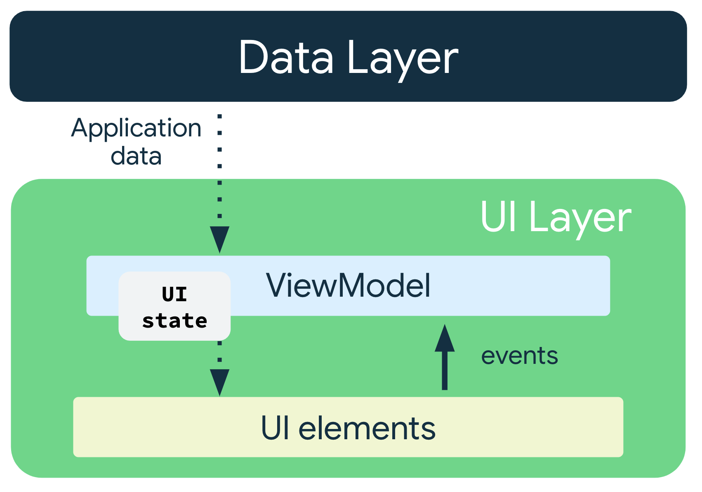

# Loxodon Framework MVI

MVI 架构框架，包含 Store 中间件、状态持久化、DevTools、组合式组件运行时，以及 UGUI 与 FairyGUI 适配。

- 包名：`com.mikinuo.loxodon-framework-mvi`
- 最低 Unity 版本：2021.3
- 依赖形态：**自包含**，无需额外安装任何包或 NuGet 组件

## 架构设计



**架构概览（流程图）**

```
用户交互
   │
   ▼
View(UI)
   │  绑定/事件
   ▼
MviViewModel
   │  EmitIntent
   ▼
Intent
   │  处理意图
   ▼
Store
   │  产生新状态
   ▼
State
   │  TryMap/绑定
   ▼
MviViewModel
   │  数据驱动
   ▼
View(UI)

（组合式组件化，可选）
ComposedWindowBase
  ├─ 组件注册表 → 组件A(View+ViewModel+Store)
  ├─ 组件注册表 → 组件B(View+ViewModel+Store)
  └─ 事件路由表 ↔ 组件A / 组件B（Props/Events）
```

**类关系图**

```
IIntent
IMviResult
IState
IMviEffect

MviViewModel / MviViewModel<TState, TIntent, TResult, TEffect>
  └─ 依赖：GeneratedStateMapper（由 SourceGenerator 生成）

Store<TState, TIntent, TResult>
  ├─ 输入：TIntent : IIntent
  ├─ 输出：TResult : IMviResult
  └─ 管理：TState : IState

Store<TState, TIntent, TResult, TEffect>
  ├─ Effects：TEffect : IMviEffect
  └─ Errors：MviErrorEffect

（组合式组件化）
ComposedWindowBase : Window
  ├─ 组件注册：IViewBinder / IPropsReceiver<T> / IForceUpdateProps
  ├─ 事件输出：ComponentEvent
  └─ 组合 DSL：Compose / Component / WithProps / On / CompareProps
```

**核心接口**

| 接口 | 职责 |
|---|---|
| `IIntent` | 意图 |
| `IMviResult` | 结果 |
| `IState` | 状态（建议使用 Record） |
| `IMviEffect` | 一次性事件（Toast / 弹窗 / 导航） |

**核心类**

| 类型 | 职责 |
|---|---|
| `MviViewModel` | 继承 `ViewModelBase`，负责绑定 Store 与发射 Intent |
| `Store` | 状态管理与结果处理 |
| `StoreMiddlewareContext` / `IStoreMiddleware` | Store 中间件扩展点（日志、鉴权、重试、埋点） |
| `IntentProcessingPolicy` | 按 Intent 类型配置并发策略（Queue / Drop / Switch / Parallel） |
| `MviSelector` | Selector 记忆化工具，降低重复计算与无效刷新 |
| `IStoreStatePersistence` | 状态持久化插件接口（支持恢复与迁移） |
| `MviDevTools` | 时间线调试工具（Intent / Result / State / Effect / Error、Replay、Time-travel） |
| `IMviErrorStrategy` / `MviErrorDecision` | 全局错误策略（重试、忽略、回退、抛出） |
| `Store.UndoState` / `RedoState` / `TryTimeTravelToHistoryIndex` | 状态历史回退能力 |
| `StoreTestKit` | Store 测试辅助 DSL（采集状态、等待条件、快速发射 Intent） |

**组合式组件化**

| 位置 | 内容 |
|---|---|
| `Core/Components` | 基础组件 |
| `Loxodon/Composed` | 组合式基类 |

## 安装

在 `Packages/manifest.json` 中加入：

```json
{
  "dependencies": {
    "com.mikinuo.loxodon-framework-mvi": "https://github.com/MiKiNuo/loxodon-framework-mvi.git"
  }
}
```

或在 Package Manager 中 `Add package from git URL` 填入：

```
https://github.com/MiKiNuo/loxodon-framework-mvi.git
```

`package.json` 位于仓库根，无需 `?path=` 参数。生产环境建议在 URL 末尾追加 `#<tag>` 锁定版本，例如 `#v0.2.0`。

安装后无需任何手动步骤，Unity 自动完成导入与编译。

## 包内已内置的依赖

| 依赖 | 版本 | 位置 | 说明 |
|---|---|---|---|
| R3 运行时 | NuGet 1.3.0 | `ThirdParty/R3/Plugins/` | `R3.dll` 及 5 个 NuGet 依赖程序集 |
| R3 Unity 适配层 | 1.3.1 | `ThirdParty/R3/Unity/` | 提供 `ObserveOnMainThread`、`UnityFrameProvider`、Triggers 等 |
| Loxodon Framework 运行时 | 2.6.7 | `ThirdParty/Loxodon/` | 仅 `Framework` 与 `Log` 两个程序集 |
| FairyGUI | 上游 master | `ThirdParty/FairyGUI/` | 运行时、编辑器与 Resources |

## 不要重复安装

包内已包含上述依赖，**请勿同时安装**以下任意一项，否则会出现同名程序集或重复类型冲突：

- `com.cysharp.r3`（R3 的 UPM 集成层）
- NuGet 版 `R3` 及其依赖（通过 NuGetForUnity 安装）
- `com.vovgou.loxodon-framework`（Loxodon Framework 官方包）
- FairyGUI 官方包或 `.unitypackage`

## 验证安装

1. Console 无 `CS0246`、`CS0433` 或 `Multiple precompiled assemblies` 报错。
2. `Library/ScriptAssemblies` 下生成 `MVI.Core.dll`、`MVI.Loxodon.dll`、`MVI.FairyGUI.dll`、`Loxodon.Framework.dll`。

## 包内结构

| 目录 | 内容 |
|---|---|
| `Core/` | MVI 核心运行时 |
| `Loxodon/` | Loxodon 集成与 UGUI 适配 |
| `FairyGUI/` | FairyGUI 集成与适配 |
| `Editor/` | 编辑器工具（DevTools 窗口） |
| `Analyzers/` | 源生成器（`MviMap` / `MviIgnore` 映射优化） |
| `ThirdParty/` | 内置的 R3、Loxodon、FairyGUI |

不包含 Demo 与业务示例，示例不在包内分发。

## Demo 使用方法

示例位于独立的开发工程中，入口场景为
`mvi-dev/Assets/Samples/Loxodon Framework/2.0.0/Examples/Launcher.unity`，打开运行即可。

在 `Launcher` 上设置 `demoUiKind` 切换 UI 方案：

| 值 | 说明 |
|---|---|
| `UGUI` | 运行 UGUI 组合式 Demo |
| `FairyGUI` | 运行 FairyGUI 组合式 Demo |

组合式 Demo 相关代码位于
`mvi-dev/Assets/Samples/Loxodon Framework/2.0.0/Examples/Scripts/Views/UI/`，
其中 `Composed/` 为组合式实现，`FairyGUI/` 为 FairyGUI 适配实现。

## 第三方同步

内置的第三方库通过仓库根目录的 `Tools~/sync-thirdparty.py` 与上游保持一致：

```bash
python Tools~/sync-thirdparty.py --check                  # 检查上游可达性
python Tools~/sync-thirdparty.py fairygui                 # 同步 FairyGUI（master）
python Tools~/sync-thirdparty.py loxodon --ref v2.6.7     # 同步 Loxodon 指定 tag
python Tools~/sync-thirdparty.py r3 --r3-version 1.3.0    # 同步 R3 NuGet 程序集
python Tools~/sync-thirdparty.py all
```

同步采用覆盖写入，上游已删除的文件会列在输出中，需人工确认后清理。同步会跳过 `.meta`（保持资源 GUID 稳定）与 `.asmdef`（保留本地集成补丁）。FairyGUI 上游仓库不提供 `package.json`，无法作为 UPM 依赖引用，只能以此方式同步。

## 已知约束

- **版本锁定**：包内第三方库版本随包版本冻结。需要不同版本时，请修改 `Tools~/sync-thirdparty.py` 中的版本常量并重新同步。
- **FairyGUI 补丁**：若对 `ThirdParty/FairyGUI` 有本地修改，同步时会被上游覆盖，请改为在 `FairyGUI/` 适配层中扩展。

## 致谢

[Loxodon Framework](https://github.com/vovgou/loxodon-framework) 是一个 MVVM 双向数据绑定框架，在代码质量、可读性、性能等方面非常优秀，本项目的数据绑定能力建立在其之上。
